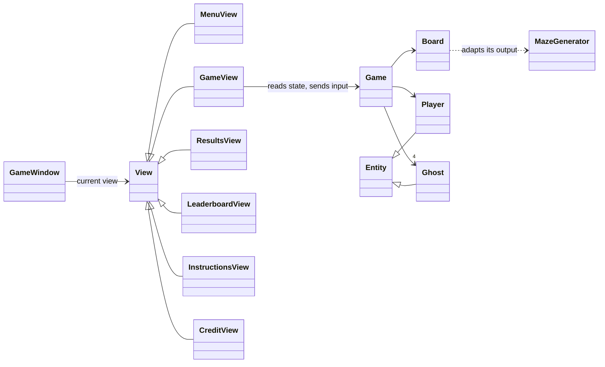

*This project has been created as part of the 42 curriculum by rkadri, asaqi.*

<!-- TODO(team): confirm the login order above. -->

# Pac-Man — Ghosts! More ghosts!

## Description

A remake of the 1980 Namco arcade classic, written in Python with
[pyglet](https://pyglet.org/). Every level is a fresh maze produced by an
external *A-Maze-ing* package, which our loader turns into a Pac-Man playfield: pacgums in every corridor,
super-pacgums and ghosts in the four corners, Pac-Man in the middle.

Features:

- 10 levels of increasing difficulty: ghosts get faster and the time limit
  shrinks at every level.
- Four ghosts with distinct targeting, real path-finding (BFS), and the three
  classic states: chasing, frightened (edible) and eaten (eyes return home).
- A configuration file in JSON with `#` comments, validated with safe defaults.
- A persistent top-10 leaderboard.
- Main menu, instructions, credits, in-game HUD, pause menu, game-over and
  victory screens with name entry.
- A cheat mode to make peer review easy.

## Instructions

### Requirements

- [uv](https://docs.astral.sh/uv/) (it installs the right Python version,
  3.14, automatically if needed).
- A machine with a display and OpenGL support (pyglet).
- The game runs fullscreen and draws on a 1448 × 1028 canvas centred on
  the screen, so a screen of at least that size is recommended.

### Install and run

```sh
make install   # uv sync: creates .venv, installs pyglet, the maze package
               # and the dev tools (flake8, mypy, ruff, PyInstaller)
make run       # runs: uv run pac-man.py config.json
```

Or with any config file:

```sh
uv run pac-man.py path/to/config.json
```

The program takes exactly one argument: the configuration file. Its path is
relative to the folder you launch the game from.

Other Makefile rules:

| Rule           | Effect                                                       |
|----------------|--------------------------------------------------------------|
| `make debug`   | Runs the game under `pdb`, with `config.json`                |
| `make lint`    | `flake8 .` and `mypy .` with the flags required by the subject |
| `make format`  | Formats the code with `ruff format`                          |
| `make clean`   | Removes `__pycache__`, `.mypy_cache`, `.ruff_cache`, `dist`  |
| `make package` | Builds the standalone game (see below)                       |

### Packaged build

<!-- TODO(team): add the Itch.io link. -->
The game is published on Itch.io as a free, unlisted build: **TODO: link**.

It is built with [PyInstaller](https://pyinstaller.org/) from the spec file at
the root of this repository, `pac-man.spec`:

```sh
make package
```

This creates the game folder `dist/pac-man/` and the archive
`dist/pac-man-linux.zip` for Itch.io. The build is for Linux and doesn't need
Python to be installed.

In the packaged game:

- Double-click `pac-man`, or run `./pac-man` from the game folder. Without an
  argument it uses the bundled `_internal/config.json`; `./pac-man my_config.json`
  uses your own file instead.
- `_internal/HOW_TO_PLAY.txt` lists the controls, the cheats and the
  configuration keys.
- The leaderboard is saved in `_internal/`.

### Controls

| Action                 | Keys                                  |
|------------------------|---------------------------------------|
| Move                   | Arrow keys, `W A S D`, or `H J K L`   |
| Menu navigation        | Up / Down, then `Enter` or `Space`    |
| Back (sub-menus)       | `Esc`                                 |
| Pause / resume         | `Esc`                                 |
| Quit to main menu      | `Q` while paused                      |
| Enter your name        | Letters, digits, space, `Backspace`, `Enter` to save |

### Cheat mode

Available during play (not while paused or during the "Ready!" screen):

| Key | Cheat                                                          |
|-----|----------------------------------------------------------------|
| `I` | Toggle invincibility (Pac-Man turns translucent; ghosts can't kill him) |
| `N` | Skip the current level (on level 10, wins the game)            |
| `E` | Add an extra life                                              |

<!-- TODO(team): update this table if you add more cheats (ghost freeze, speed, time). -->

## Configuration

The configuration file is JSON. In addition, **any line whose first
non-blank character is `#` is a comment** and is ignored. (Comment lines are
replaced by empty lines before parsing, so JSON error messages still point to
the right line number.)

Example:

```json
# Pac-Man configuration
{
  "highscore_filename": "leaderboard.json",
  # width and height of the maze, in cells
  "level": [10, 10],
  "lives": 3,
  "points_per_pacgum": 10,
  "points_per_super_pacgum": 50,
  "points_per_ghost": 200
}
```

### Keys

| Key                       | Type              | Default              | Allowed values            |
|---------------------------|-------------------|----------------------|---------------------------|
| `highscore_filename`      | string            | `"leaderboard.json"` | a file name ending in `.json` |
| `level`                   | `[width, height]` | `[10, 10]`           | each between 5 and 25     |
| `lives`                   | integer           | `3`                  | 1 – 99                    |
| `points_per_pacgum`       | integer           | `10`                 | 1 – 100000                |
| `points_per_super_pacgum` | integer           | `50`                 | 1 – 100000                |
| `points_per_ghost`        | integer           | `200`                | 1 – 100000                |

`level` is measured in maze **cells**; the playfield in tiles is
`(2 × width + 1) × (2 × height + 1)` (see *Maze Generation*). All levels use
the same size; the maze itself changes every level.

### Faulty configuration

| Problem                                         | Behaviour                                         |
|-------------------------------------------------|---------------------------------------------------|
| Missing key                                     | Warning printed, default value used               |
| Value out of range or of the wrong type         | Warning printed, default value used               |
| Infinite or invalid numbers (`1e999`, `Infinity`, `NaN`) | Warning printed, default value used      |
| Booleans for integer keys (`true`, `false`)     | Rejected, default used                            |
| Numbers given as strings or floats (`"5"`, `5.9`) | Converted with `int()` (`5`)                    |
| `highscore_filename` not text, not ending in `.json`, or containing a NUL character | Warning printed, `leaderboard.json` used |
| Unknown key                                     | Warning printed, key ignored                      |
| Missing / unreadable file                       | Clear error message, program exits                |
| Invalid JSON                                    | Error message with the line number, program exits |
| Top level is not a JSON object                  | Clear error message, program exits                |

In every case the program prints a message and never shows a Python
traceback. Any other unexpected error is printed as `[ERROR]: <message>` and
the program exits with status 1.

## Highscore

Scores are stored in the JSON file named by `highscore_filename`
(default `leaderboard.json`; the name must end in `.json`).

The path is relative to the **game's folder**, not to the folder you launch
from. At start-up the program moves into its own folder (the one containing
`pac-man.py`, or `_internal/` in the packaged build) so that it finds its
assets wherever it is launched from.

The file is a list of single-entry objects, name to score:

```json
[
    { "ASAQI": 26300 },
    { "RKADRI": 15490 }
]
```

- **Saving.** At the end of every game, win or lose, the player types a name:
  letters and digits (stored uppercase) and spaces, at most 10 characters, not
  blank. Pressing `Enter` reads the file, keeps the valid entries, and either
  adds the new entry or, if that name already exists, keeps the higher of the
  two scores. The file is then rewritten.
- **Loading and display.** *Leaderboard* in the main menu reads the file,
  drops any invalid entry (non-integer or negative score, malformed object),
  sorts by score and shows the top 10, with gold, silver and bronze for the
  first three places.
- **Robustness.** A missing file means an empty leaderboard. Invalid JSON or a
  file that is not a list prints a warning and is treated as empty; the next
  save replaces it with a valid leaderboard. If the file cannot be written, a
  warning is printed and the game carries on.

**Why this design.** <!-- TODO(team): confirm or rewrite this reasoning. -->
A small JSON file needs no extra dependency, survives restarts, and can be
opened and checked by hand during an evaluation. Keeping one entry per name
(the player's best score) stops a single player from filling the whole top 10
with repeated attempts.

## Maze Generation

### The package

We use the A-Maze-ing package assigned to us, `mazegenerator` 2.1.0, without
any modification. It is installed from the wheel shipped in
`mazegenerator-00001/` through `[tool.uv.sources]` in `pyproject.toml`, so it
can be re-installed as-is.

```python
MazeGenerator(size=(width, height), seed=seed)
```

- The maze is generated in the constructor.
- `perfect` is left at its default, `False`: the package then removes dead
  ends, which gives the loops Pac-Man needs.
- **Level 1 uses the fixed seed `42`.** Later levels use seed `0`, which this
  package treats as "random".

`MazeGenerator.maze` is a grid of `height` rows × `width` integers. Each
integer is a 4-bit mask of the walls around that cell:
`1` = north, `2` = east, `4` = south, `8` = west. A value of `15` is a fully
sealed cell; the package uses these to stamp a "42" logo in the middle of mazes
of at least 14 × 10 cells.

### From cells to tiles

In the package, walls are the thin *edges* between cells. In Pac-Man, walls
have to be squares that can be drawn and tested, so `Board` (`src/maze.py`)
converts the cell grid into a tile grid of `(2 × width + 1) × (2 × height + 1)`:

```
cells (2 × 2)          tiles (5 × 5)
+---+---+              # # # # #
| A   B |              # A . B #
+---+   +              # # # . #
| C | D |              # C # D #
+---+---+              # # # # #
```

1. Start with every tile as a wall.
2. Each cell `(x, y)` becomes the tile `(2x + 1, 2y + 1)` and is carved, unless
   it is a sealed `15` cell.
3. If the cell has no east wall, the tile between it and its right neighbour,
   `(2x + 2, 2y + 1)`, is carved. Same with the south wall and `(2x + 1, 2y + 2)`.
4. Tiles with both coordinates even are corner posts and stay walls, and so
   does the outer border.

Placing things on the board:

- **Super-pacgums and ghosts:** the four corner cells.
- **Pac-Man:** the gap between the "4" and the "2" of the logo, which is the
  middle of the maze (or the centre cell when the maze is too small for the
  logo).
- **Pacgums:** every other walkable tile.

If maze generation fails, the error is caught by the program's top-level
handler, printed as `[ERROR]: <message>`, and the game exits without a
traceback.

## Implementation

### Game loop and screens

`GameWindow` (a fullscreen `pyglet.window.Window`) schedules `update` at
60 Hz and forwards `update`, `draw` and key presses to the current `View`.
A view switches screens by returning the next view:

```
Menu ──► Game ──► Results (game over / victory + name) ──► Menu
  ├──► Leaderboard ──► Menu
  ├──► Instructions ──► Menu
  └──► Credit ──► Menu
```

The game logic (`Game`, `Board`, `Player`, `Ghost`) never imports pyglet. The
views read its state and draw it.

### Movement

Entities (`Entity`, then `Player` and `Ghost`) live on integer tiles. Each one
has a direction and a `progress` value between 0 and 1 toward the next tile;
`speed` is in tiles per second. When `progress` reaches 1, the entity arrives
on the next tile and chooses its next direction. Drawing uses the interpolated
`visual_position()`, so motion is smooth while all the rules stay on the
integer grid.

The player's last key press is buffered (`dir_wanted`) and applied at the first
tile where that direction is open. This lets you press a turn slightly before a
junction, like in the arcade. Pac-Man and a ghost collide when they are less
than half a tile apart on both axes.

### Ghost AI

Each ghost is in one of three modes:

- **Chase.** The ghost runs a breadth-first search from its target tile to
  get the real walking distance from every tile. At each tile it steps to the
  neighbour with the smallest distance. The search only runs again when the
  target tile changes. Each ghost has its own target:

  | Ghost | Target                                    |
  |-------|-------------------------------------------|
  | 0     | Pac-Man                                   |
  | 1     | 2 tiles to the right of Pac-Man           |
  | 2     | 2 tiles below Pac-Man                     |
  | 3     | 4 tiles up and 4 tiles left of Pac-Man    |

  If that tile is a wall, the ghost targets Pac-Man himself. Ghosts don't
  reverse (except in a dead end), and they avoid tiles that another ghost is
  on or about to enter, so they spread out instead of stacking.
- **Frightened** (after a super-pacgum). Ghosts turn around once, slow down to
  0.7× their speed, and step to the neighbour *farthest* from Pac-Man. When
  Pac-Man is within 7 tiles they may also turn back, so they don't run into him
  at the end of a corridor.
- **Eaten.** The ghost becomes a pair of eyes that move at 2× speed along a
  precomputed distance map back to its corner. After 10 seconds it comes back
  as a normal ghost in its corner.

### Difficulty

| Parameter            | Value                                                    |
|----------------------|----------------------------------------------------------|
| Levels               | 10                                                       |
| Pac-Man speed        | 7 tiles/s                                                |
| Ghost speed          | `5 + 0.23 × (level − 1)` tiles/s, slightly faster than Pac-Man on level 10 |
| Time limit           | `pacgums × 1 s × 0.9^(level − 1)`: proportional to the maze, 10 % shorter each level |
| Super-pacgum effect  | `min(30 s, 0.04 s × pacgums)`                            |
| Time runs out        | Game over                                                |

The score carries over between levels and only ever increases. Lives are reset
to the configured `lives` value at the start of every level.

### Rendering

The walls and pacgums are painted once per level, pixel by pixel, into an RGBA
buffer that becomes a single image (`pyglet.image.ImageData`). When a pacgum is
eaten, its square is overwritten in that image. Pac-Man, the ghosts and the
super-pacgums are sprites drawn on top. Text uses the *Press Start 2P* font.

## General Software Architecture

```
pac-man.py               entry point: arguments, config, moves into its own
                         folder, error messages
pac-man.spec             PyInstaller build spec (make package)
HOW_TO_PLAY.txt          instructions shipped with the packaged game
config.json              default configuration
Makefile                 install, run, debug, lint, format, clean, package
src/
├── utils/
│   ├── parser.py        Parser: JSON with # comments, validation, defaults
│   └── entity.py        Direction, Entity (abstract): tile movement
├── maze.py              Board: maze package output → tile grid, spawns
├── player.py            Player(Entity): buffered keyboard direction
├── ghost.py             GhostMode, Ghost(Entity): BFS chase / flee / return
├── game.py              Game: levels, timers, score, lives, collisions
├── game_window.py       GameWindow: pyglet window, 60 Hz loop, view switching
├── views/
│   ├── view.py          View: base class + label/title/image helpers
│   ├── menu.py          MenuView
│   ├── game.py          GameView: maze image, sprites, HUD, pause, cheats
│   ├── results.py       ResultsView: game over / victory, name entry, save
│   ├── leaderboard.py   LeaderboardView: top 10
│   ├── instructions.py  InstructionsView
│   └── credit.py        CreditView
├── entities/pacman.py   Pacman sprite: chomp animation, facing
├── constants.py         window size, FPS, colours
└── types.py             Color type alias
assets/                  images and font
```



There are two layers:

- **Model** (`game.py`, `maze.py`, `player.py`, `ghost.py`, `utils/`): plain
  Python, no graphics. It can run and be tested without a window.
- **Presentation** (`game_window.py`, `views/`, `entities/`): pyglet. It reads
  the model and turns key presses into model calls (for example
  `player.dir_wanted`).

`Game` owns everything that belongs to one level and rebuilds it when the level
changes. When a new level starts, `GameView` notices that `Game` has a new
`Board` and redraws the maze image.

## Project Management

<!-- TODO(team): fill in from the project-management directory once it exists. -->

We were a team of two and split the work by layer:

- **asaqi:** configuration parser, maze adapter (`Board`), entities and
  movement, ghost AI, game rules (`Game`).
- **rkadri:** pyglet window and views, rendering, HUD, pause and cheat mode,
  leaderboard and results screens, assets.

The work was tracked with **TODO: ......(KHASSNA NDIRO HAD PART MN B3D)

## Resources

<!-- TODO(team): keep only the references you actually used, and add your own. -->

- Jamey Pittman, *The Pac-Man Dossier*: <https://pacman.holenet.info/>
- Chad Birch, *Understanding Pac-Man Ghost Behavior*:
  <https://gameinternals.com/understanding-pac-man-ghost-behavior>
- pyglet documentation: <https://pyglet.readthedocs.io/>
- Breadth-first search: <https://en.wikipedia.org/wiki/Breadth-first_search>
- uv documentation: <https://docs.astral.sh/uv/>
- PEP 8 and PEP 257: <https://peps.python.org/pep-0008/>,
  <https://peps.python.org/pep-0257/>
- *Press Start 2P* font by CodeMan38, SIL Open Font License
  (`assets/fonts/OFL.txt`)

### How AI was used

<!-- TODO(team): check this, and add rkadri's own use of AI. -->

**asaqi** used AI, mostly in spliting tasks and testing edge cases:

- **Design discussions:** how to split `Board`, `Entity`, `Player`, `Ghost` and
  `Game`, the order of steps in `Game.update`, and the formulas that scale time
  and ghost speed with the level.
- **Robustness review:** edge cases in the configuration parser (`1e999`, a NUL
  character in the highscore file name) and pitfalls of the packaged build
  (asset paths, a default config when no argument is given).
- **Testing:** a throwaway test window (not part of the repository) used to
  check the maze adapter.
- **Documentation:** Structuring this README and its updates.

**rkadri:** TODO. (HADI NTA LI KHASS DIRHA)
